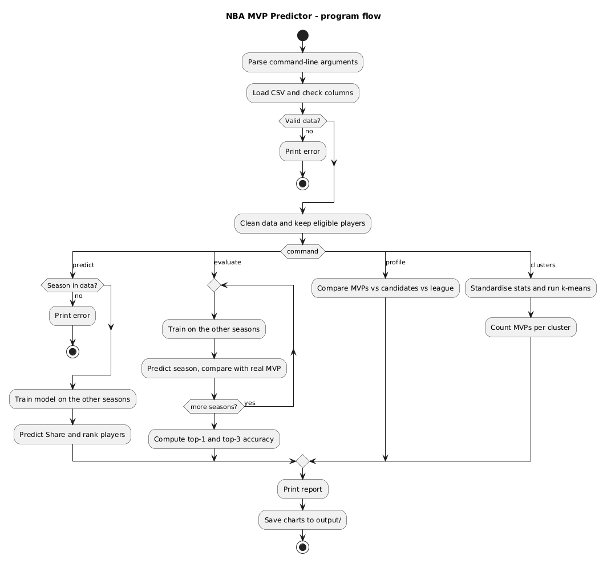
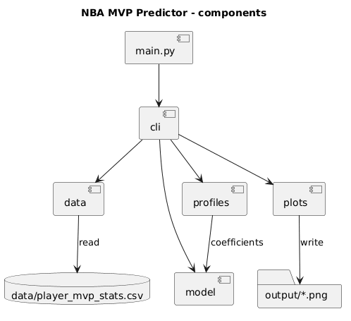

# Design

## Data

One CSV row = one player in one season (1991–2021, 14 092 rows), from the public
[Dataquest MVP dataset](https://github.com/dataquestio/project-walkthroughs/tree/master/mvp).
It is stored in the repository as `data/player_mvp_stats.csv` (source and terms: [data/README.md](../data/README.md)).

| Group | Columns used |
|---|---|
| Identification | `Player`, `Pos`, `Year`, `Tm` |
| Player stats (per game) | `G`, `MP`, `PTS`, `AST`, `TRB`, `STL`, `BLK`, `TOV`, `FG%`, `3P%`, `FT%` |
| Team | `W`, `L`, `W/L%` |
| MVP voting (target) | `Share` = points won / maximum points (0 = no votes) |

`Pts Won` and `Pts Max` are **not** used as features: they are the target itself.

**Eligible player** = played at least half of their team's games (`G >= (W + L) / 2`).
A relative rule works for short seasons too (1999: 50 games, 2012: 66 games).

## Inputs

Command-line arguments:

| Command | Arguments | Meaning |
|---|---|---|
| `predict` | `SEASON`, `--top N` (default 5) | Predict the MVP race of one past season |
| `evaluate` | — | Predict every season and measure how often the model is right |
| `profile` | — | Compare MVP winners with other candidates and with the league |
| `clusters` | `--k K` (default: chosen by silhouette) | Group players into archetypes, show where MVPs fall |

Common options: `--data PATH` (CSV location, default `data/player_mvp_stats.csv`), `--output DIR` (where charts are saved, default `output/`).

## Outputs

- A text report printed to the console.
- PNG charts saved to `output/`.
- On invalid input (unknown season, missing file or columns) a short error
  message and exit code 1.

Example (format only):

```
$ python main.py predict 2016 --top 3
Season 2016: model trained on the other 30 seasons
Rank  Player              Predicted share  Real share
1     Stephen Curry       x.xx             1.000  (MVP)
2     ...
Predicted MVP: Stephen Curry  | Real MVP: Stephen Curry  -> correct
```

## Logic

1. **Load**: read the CSV, check the required columns.
2. **Clean**: empty percentages (e.g. `3P%` of players who never shot a three) become 0; keep eligible players.
3. **Predict a season** (*leave-one-season-out*): train a linear regression on `Share` with all seasons
   except the one asked, predict `Share` for its players, sort descending. The asked season is never seen
   during training, so the result is an honest test.
4. **Evaluate**: repeat step 3 for all 31 seasons; report top-1 accuracy (predicted MVP = real MVP) and
   top-3 accuracy (real MVP among the 3 highest predictions).
5. **Profile**: mean stats of MVP winners vs other vote receivers vs all eligible players; model
   coefficients show which stats raise the predicted share.
6. **Clusters**: standardise the stats, run k-means, describe each cluster by its strongest stats,
   count MVPs per cluster and per decade.

Activity diagram of the program flow:



Components (modules) and their dependencies:


